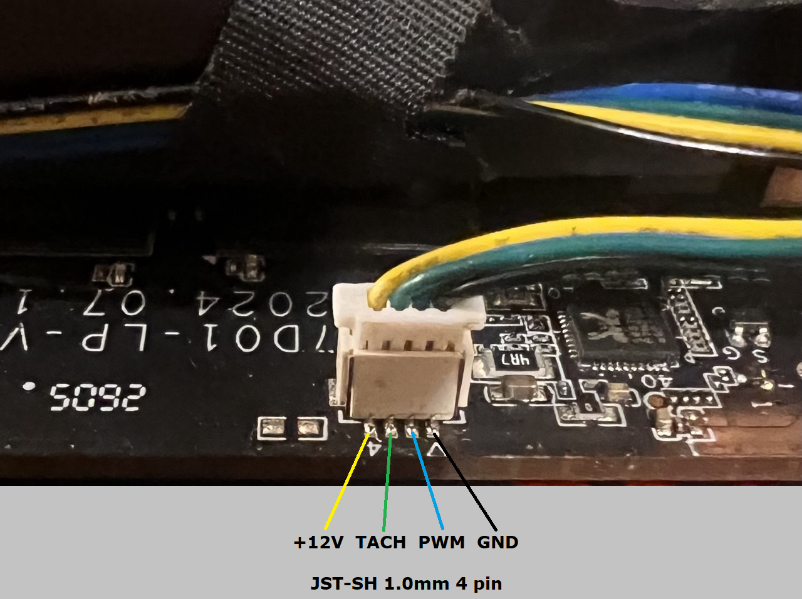
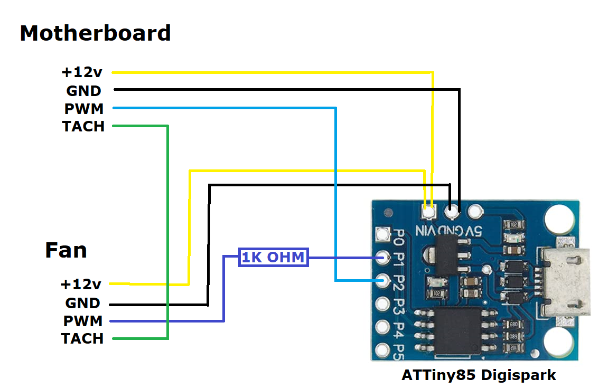

# Fan pwm reader/generator (proxy) based on ATTiny85 configured for Genmachine YI7000LP


```
Default fan behavior on GenMachine YI7000LP
Temperature     Action
0-39            PWM 0%
40              no change (HOLD)
41-49           30%
50-55           HOLD
56-59           40%
60-65           HOLD
66-74           70%
75-80           HOLD
81 and above    100%
```

Fan behavior is adjustable in RISE[] and FALL[] tables (unfortunately only based on PWM generated by motherboard, no temperature)

```
rise = table applied if pwm input increases
fall = table applied if pwm input decreases
from/to = input pwm range from motherboard
output = output pwm on that range

static const Rule RISE[] PROGMEM = {
    //  from   to   output
    {   0,    39,     0 },
    {  40,    69,    30 },
    {  70,    80,    60 },
    {  81,   100,   100 },
};

static const Rule FALL[] PROGMEM = {
    //  from   to   output
    {   0,    29,     0 },
    {  30,    69,    30 },
    {  70,    74,    60 },
    {  75,   100,   100 },   
};
```

## Materials:

```
-ATTiny85 board from Digispark
-JST-SH 1.0mm 4pin plug and socket (+cables)
-0.5-1k Ohm resistor
```

CPP + PlatformIO




